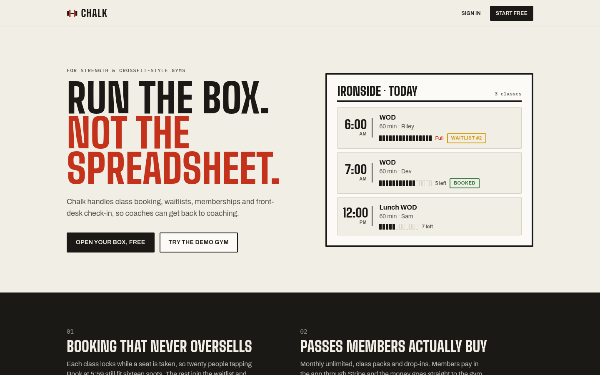
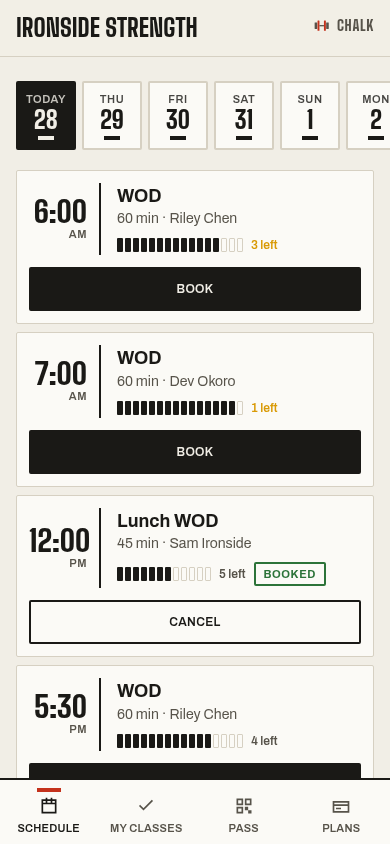
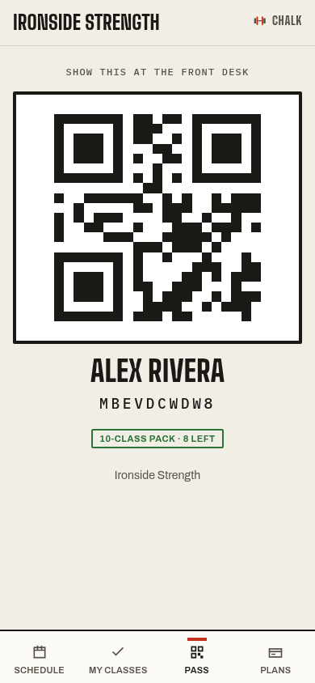
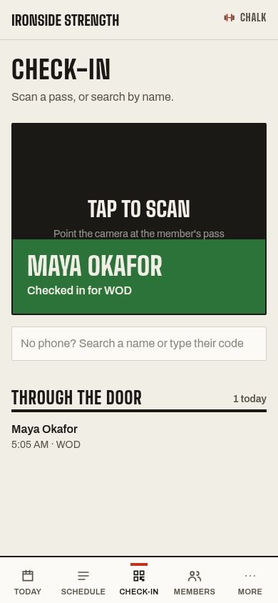
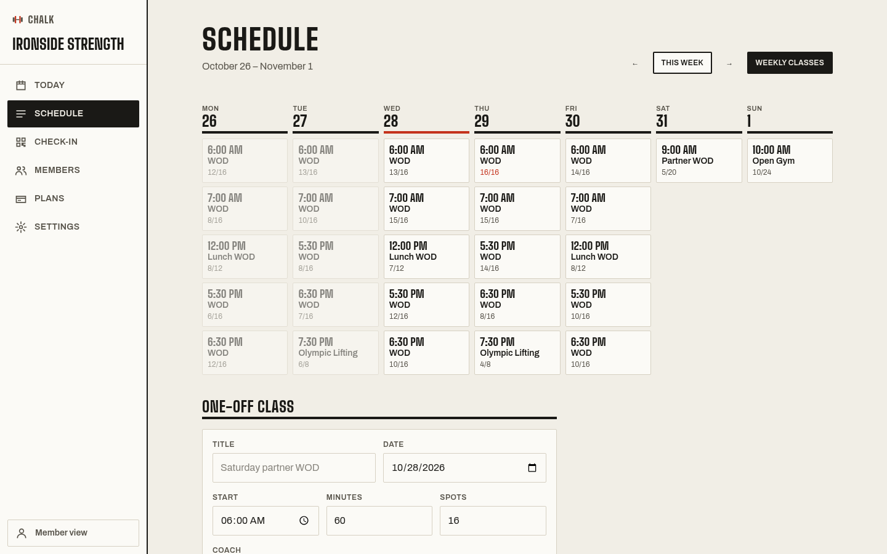
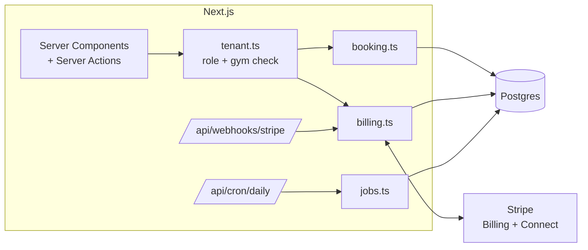

# Chalk

Class booking, memberships and front-desk check-in for strength and CrossFit-style gyms.

**[Live demo → chalk-box.vercel.app](https://chalk-box.vercel.app)** · sign in as `owner@chalk.dev`, `coach@chalk.dev`
or `member@chalk.dev` with password `chalkdemo`. The demo resets every night.

A gym signs up, sets a weekly timetable and its membership plans, and members book classes, buy passes and
check in at the door from their phones. Chalk is multi-tenant: one deployment serves any number of gyms, and one
login can coach at one gym and train at another.



| Member app (phone)                                    | Pass                                          | Front desk                                   |
| ----------------------------------------------------- | --------------------------------------------- | -------------------------------------------- |
|  |  |    |



## What it does

**For members**

- Book a class in one tap, or join the waitlist when it's full and get moved in automatically when a spot opens.
- Buy a monthly unlimited membership, a class pack or a drop-in with Stripe.
- Show a QR pass at the door.
- Cancel up to two hours before class and get the credit back.

**For coaches and owners**

- Weekly timetable templates that fill the schedule two weeks ahead.
- Rosters, waitlists, attendance and no-shows for every class.
- A front-desk check-in screen that scans passes with the camera, or finds people by name.
- Members, plans, cash payments, coach invites and an activity log.
- A Today dashboard with bookings, check-ins, members and revenue.

**For the business**

- Free plan for up to 30 active members; Pro at $49/month removes the cap (Stripe Billing).
- Member payments go to the gym through Stripe Connect (Express accounts, destination charges, 2% platform fee).

## Try it

```bash
docker compose up -d            # Postgres 17 on localhost:5433
cp .env.example .env            # then fill in the Stripe test keys
npm install
npm run db:migrate
npm run stripe:setup            # creates the Pro price; paste the id into .env
npm run db:seed                 # demo gym "Ironside Strength"
npm run dev
```

Demo logins all use the password `chalkdemo`:

| Role   | Email              | Lands on                 |
| ------ | ------------------ | ------------------------ |
| Owner  | `owner@chalk.dev`  | `/g/ironside/admin`      |
| Coach  | `coach@chalk.dev`  | `/g/ironside/admin`      |
| Member | `member@chalk.dev` | `/g/ironside`            |

Payments run in Stripe test mode only: the app refuses to start a Stripe client with a live key. Use card
`4242 4242 4242 4242` with any future expiry and CVC.

To receive webhooks locally, forward them with the Stripe CLI and put the printed secret in `STRIPE_WEBHOOK_SECRET`:

```bash
stripe listen --forward-to localhost:3000/api/webhooks/stripe --forward-connect-to localhost:3000/api/webhooks/stripe
```

Without it, purchases still complete: the Checkout return page confirms the session with Stripe directly.

## How it works



### Tenancy

Gyms live at `/g/[slug]` (member app) and `/g/[slug]/admin` (staff app). Every tenant table carries `gym_id`.
Pages and actions resolve the gym and the caller's role on the server through `requireStaff` / `requireMember`
in `src/lib/tenant.ts`, so a `gym_id` never comes from the client. Roles live on `staff` and `member` rows, not on
the user, which is what lets one person belong to several gyms.

### Booking without overselling

`bookClass` in `src/lib/booking.ts` runs in a transaction that takes a `SELECT … FOR UPDATE` lock on the class
row, counts taken seats, then either books (debiting a pack credit) or waitlists. Concurrent bookings for the same
class queue behind the lock, so capacity holds even when everyone taps Book at 5:59. The test suite fires 20
simultaneous bookings at a 12-spot class and checks that exactly 12 get in.

The same lock protects cancellations, capacity changes and waitlist promotion. Promotion takes the oldest waiting
member who still has a usable pass and charges it then; people whose pass ran out while waiting are skipped.

### Payments

Two layers, both in `src/lib/billing.ts`:

1. **Gym → Chalk.** Stripe Checkout in subscription mode, Billing Portal for changes. Webhooks flip
   `gym.saas_plan`. The member cap is enforced in one function (`createMember`), which locks the gym row so two
   signups can't both take the 30th seat.
2. **Member → gym.** Checkout with inline `price_data`, so plan edits never need price syncing. Packs and
   drop-ins are one-off payments with `application_fee_amount`; monthly plans are subscriptions with
   `application_fee_percent`. Both use `transfer_data.destination` to pay the gym's connected account.

Fulfilment is idempotent from both ends: webhook event ids are recorded in `stripe_event`, and memberships are
unique on the Checkout session id, so a webhook, a retry and the success redirect can all arrive and only one pass
is created.

### Background work

`/api/cron/daily` (a Vercel Cron, protected by `CRON_SECRET`) marks no-shows in finished classes, clears stale
waitlists, tops the schedule up to 14 days and expires lapsed cash passes. Every step is safe to run twice.

### Time zones

Classes are stored in UTC and shown in the gym's time zone. Templates are expanded with a small `Intl`-based
converter in `src/lib/time.ts`, tested across a DST change.

## Design

The visual direction comes from the gym itself: chalk on a whiteboard, rubber floors and painted competition
plates. Plate colours (red, blue, yellow, green) are used only for meaning: booked, waitlisted, full, failed.
Headings use Big Shoulders, body text uses Archivo, and codes use IBM Plex Mono. The member app is built
phone-first with a bottom tab bar and 48px touch targets; the staff app switches between a sidebar and a tab bar.
Light and dark themes follow the system. The full spec is in [`docs/design.md`](docs/design.md).

## Tests

```bash
npm test
```

32 tests run against a real Postgres database (`TEST_DATABASE_URL`). They cover booking, credits,
late cancels, waitlist promotion, concurrency, tenant isolation, check-in, schedule generation across time
zones, the nightly job, and the Stripe webhook (signature checks, idempotency, plan and membership changes),
using locally signed events.

## Stack

Next.js 16 (App Router, Server Actions) · TypeScript · Tailwind CSS 4 · Postgres 17 · Drizzle ORM ·
Better Auth · Stripe · Vitest

## Deploying

The live demo runs on Vercel (functions in `sin1`, next to a Neon Postgres database in Singapore).

1. Create a Vercel project from the repo and add a Neon database from the Storage tab; that sets `DATABASE_URL`.
2. Set the other variables from `.env.example`. `DEMO_MODE=1` shows the demo logins and reseeds the demo gym
   on the nightly cron.
3. `npm run stripe:setup -- https://your-app.vercel.app` creates the Pro price and the webhook endpoint and
   prints `STRIPE_PRO_PRICE_ID` and `STRIPE_WEBHOOK_SECRET`.
4. Push. The `vercel-build` script runs migrations before `next build`.

## Not in v1

Real email delivery (mail is logged to the server console, and invite links can be copied from settings),
custom domains, multiple locations per gym, and workout logging.
